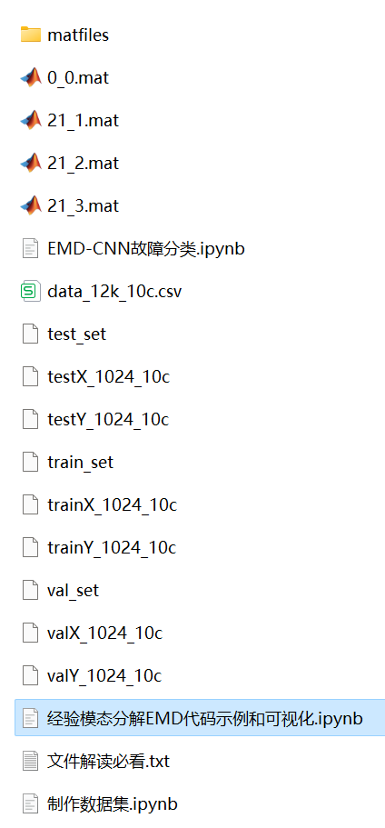

# Python-based EMD-CNN Bearing Fault Classification

The translation is as follows:

Includes a complete bearing fault dataset, as well as a one-dimensional fault signal dataset, classification data, and label set that have been generated and prepared. The corresponding codes can be run.
Includes code for EMD preprocessing of the data, as well as EMD-CNN classification code.
Environment: Python 3.9

## Images

<!-- PAYMENT_BLOCK -->

## Get this dataset

- Payment link (Stripe): [Buy now](https://buy.stripe.com/3cs8yP7sY87d0vu9AB)
- Payment QR code: 

<!-- /PAYMENT_BLOCK -->
